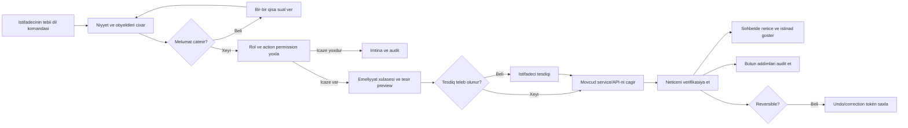

# SuperOptic vahid UX, funksional audit ve kecid plani

Tarix: 2026-07-19  
Status: Tesdiq gozleyir  
Icazə: Bu sened ve modul auditleri yoxlanmadan mehsul kodu deyisdirilmir

## 1. Sened paketi

Bu master sened route siyahisini funksional audit kimi teqdim etmir. Modul uzre frontend, action/API, service, DB, xarici inteqrasiya, rol, audit, test, mock ve E2E neticesi ayrıca hesabatlarda verilib:

- [Billing funksional auditi](33_BILLING_FUNCTIONAL_AUDIT.md)
- [Maliyye funksional auditi](34_FINANCE_FUNCTIONAL_AUDIT.md)
- [HR funksional auditi](35_HR_FUNCTIONAL_AUDIT.md)
- [Anbar funksional auditi](36_INVENTORY_FUNCTIONAL_AUDIT.md)
- [Sebeke/NOC funksional auditi](37_NETWORK_NOC_FUNCTIONAL_AUDIT.md)
- [Mesaj Merkezi ve WhatsApp funksional auditi](38_MESSAGE_CENTER_FUNCTIONAL_AUDIT.md)

## 2. Fakt statusu

| Status | Istifade qaydasi |
|---|---|
| Tesdiqlenib | Kod, SQL ve ya tehlukesiz test subutu var |
| Qismen tesdiqlenib | Axinin bir hissesi subut olunub, tam E2E yoxdur |
| Yoxlanilmayib | Real provider/cihaz/production veziyyeti olmadan fakt deyil |
| Mock/demo | Saxta, fixture ve ya test datasidir |
| Istifadesiz | Aktiv route/component referansi tapilmayib ve ya cari biznes axininda istifade olunmur |
| Teklif | Hedef qurlusdur; cari funksiya kimi teqdim olunmur |

Rəqəm, chart ve KPI yalniz SQL menbeyi, tarix ve filtr semantikasi ile fakt sayilir.

## 3. Indiki qurulus

### 3.1 Modul ve icaze qati

- **Tesdiqlenib:** `config.php:1163-1228` finance, HR, inventory, billing, AI, messaging, WhatsApp monitor, statistics ve network modullarini qeyd edir.
- **Tesdiqlenib:** `config.php:1231-1255` rol-modul xeritəsini verir.
- **Qismen tesdiqlenib:** `config.php:1262-1324` route-dan modul cixarir. `operations-center.php` finance/HR/inventory ucun map olunur, amma `noc`, `olt`, `bots`, `search` ve overview kimi section-lar ayrica module read-scope almaya bilir.
- **Tesdiqlenib:** menyudan gizletmek backend icaze yoxlamasi deyil. Her write action service qatinda da actor permission teleb etmelidir.

### 3.2 Cari informasiya arxitekturasi

| Sahe | Cari esas girisler | Tesdiqlenmis problem |
|---|---|---|
| Billing | Dashboard, customers, profile/edit, payments/cash, section wrappers, statistics, CRM | Eyni customer/payment melumati tekrarlanir; write permission ve audit natamamdir |
| Maliyye | 11 tab: overview, invoice, payment, income, company, expense, cash-bank, reconciliation, asset, bonus, statistics | Vahid ledger yoxdur; GET schema/seed yaza bilir; bos funksiyalar islek kimi gorunur |
| HR | 8 tab: overview, employee, attendance, leave/travel, performance, payroll, documents, statistics | HR profil ve Admin hesab/rol serhedi UI-da tam aydin deyil; payroll bridge testi ugursuzdur |
| Anbar | 13 tab: catalog, device, material, cable, technician, customer, handover, return, RMA, movement, approval, statistics | Eyni ledger ucun cox gorunus; repair/RMA ve inspection tam E2E deyil |
| Sebeke/NOC | Operations Center, NOC devices, MGS, RADIUS/IP/NAT sehifeleri | Device/backup/log tekrari; credential ve action permission riskleri |
| Mesaj Merkezi | Message Center-de 8, WhatsApp Monitor-da 10 gorunus | Canli chat, history, screen wall, audit ve settings parcalanib |
| Statistika | Qlobal merkez ve her modul daxilinde ayrica | Eyni anlayis ferqli query ve tarix semantikasi ile hesablanir |
| AI | Ayrica module wrappers ve kontekstual funksiyalar | Agent biznes servisini tekrarlamaq riski yaradir |

## 4. Tesdiqlenmis esas problemler

| Status | Sahe | Problem | Qerar |
|---|---|---|---|
| Tesdiqlenib | Billing | Payment DB commit-den sonra RADIUS yazilir; retry duplicate yarada biler | Idempotent state machine ve compensation |
| Tesdiqlenib | Billing | CSV import CSRF/MIME/size qoruması natamamdir | Upload security + preview + idempotency |
| Tesdiqlenib | Billing | Aylıq statistika `LIMIT 12` ile gunleri kesir | Query kontraktini duzelt |
| Tesdiqlenib | Maliyye | GET/render schema ve bonus seed yaza bilir | DDL/seed deploy migration-a cixarilsin |
| Tesdiqlenib | Maliyye | Xerc ve gelir ferqli, uyğunsuz ledger-lere yazilir | Vahid Finance ledger |
| Tesdiqlenib | Maliyye | E-qaime importu atomik deyil | Transaction + row result + idempotency |
| Tesdiqlenib | Maliyye | Asset writeoff tesdiqsiz ve qeyri-atomik ola biler | Maker-checker ve reversal |
| Qismen tesdiqlenib | HR | HR->Maliyye smoke testi mecburi `reason` kontraktina uygun deyil | Kontrakt ve tam E2E duzelsin |
| Tesdiqlenib | HR | HR profil yaradir, rol vermir | Saxla; rolu yalniz Admin verir |
| Qismen tesdiqlenib | Anbar | Core ledger axinlari testden kecib | Saxla, UI-ni is axinlarina qruplasdir |
| Tesdiqlenib | Anbar | Repair/RMA tam service zenciri deyil | Tamamlanana qeder islek sayma |
| Tesdiqlenib | NOC | Access override/vendor/monitor write action permission natamamdir | Go-live blocker; service-level gate |
| Tesdiqlenib | NOC | SSH password-un DB-de birbasa saxlanma yolu var | Secret reference/vault |
| Tesdiqlenib | NOC | Router registry 0-dır | Real router E2E olmadan onboarding hazir deyil |
| Tesdiqlenib | Mesaj | WhatsApp mesajlari `number_id + chat_id` ile ayridir | Hedef UI bu elaqeni kart daxilinde saxlasin |
| Tesdiqlenib | Mesaj | Davamli worker heartbeat yoxdur | Backend canonical status ve stale qaydasi |
| Mock/demo | Mesaj | Bos tarixcede production `TEST MESAJI` yarana bilir | Production mock legv edilsin |
| Tesdiqlenib | UX | Toast/dirty-form vahid sistemi yoxdur; CSS/component tekraridir | Vahid dizayn sistemi |
| Tesdiqlenib | Security | Aktiv sirrlerin local config faylinda plaintext saxlanma riski var | Sirrleri environment/secret store-a dasi ve rotate et |

## 5. Yoxlanilmamis ferziyyeler

Asagidakilar tam fakt kimi yazila bilmez:

1. Real router, MA5608T, MA5800-X7 ve ONT olmadan SSH/SNMP/CoA ve vendor parser hazirligi.
2. Real provider callback/import, SMS/WhatsApp delivery ve production retry neticesi.
3. Vergi/mezuniyyet/ezamiyyet formulunun cari Azerbaycan qanunvericiliyine tam uygunlugu; versioned legal source ile ayrica tesdiq teleb olunur.
4. Mobil UX-in butun sehifelerde problemsiz olmasi; CSS smoke real Playwright screenshot/E2E-ni evez etmir.
5. Finance bos cedvellerinin funksional hazirliq menasi; 0 setir CRUD ve reconciliation-in production-ready oldugunu subut etmir.
6. SQL count-larda test/demo datanin ayrilmasi; cari count-lar table snapshot-dir, temiz biznes KPI-si deyil.
7. WhatsApp connected badge-inin uzunmuddetli dogrulugu; real heartbeat olmadan kohne state qala biler.

## 6. Hedef qurulus

### 6.1 Esas portal menyusu

| Modul | Esas is sahələri |
|---|---|
| Is masasi | Role gore novbe, kritik alert, son emeller ve 5-7 tez action |
| Musteri xidmeti | Musteriler, yeni musteri, odenis al, muracietler, xidmet/sebeke detali |
| Maliyye | Gelir/odenis, xerc/borc, qaime/counterparty, kassa-bank/uzlasma, esas vesait |
| HR | Emekdaslar, davamiyyet, mezuniyyet/ezamiyyet, maas/vergi, performans/sened |
| Anbar | Stok, medaxil/transfer, tehvil, qaytarma/yoxlama, temir/RMA, sened/cap |
| Sebeke ve sahe | Canli sebeke, OLT/ONT/cihaz, qurasdirma, RADIUS/IP/NAT; admin detailed tools |
| Mesaj Merkezi | Canli Monitor; ayrica Gonderisler; admin provider/session drawer |
| Hesabatlar | Rol ve tarix scope-u ile canonical dataset/chart presetleri |
| Idareetme | User/rol, system/provider/router, global jurnal, AI model/automation |

### 6.2 Route-to-target xeritəsi

| Cari route/gorunus | Hedef | Keçid qerari |
|---|---|---|
| `billing-dashboard.php` | Musteri xidmeti qisa baxisi | Alias saxla |
| `billing-customers.php` | Musteriler | Saxla ve componentlesdir |
| `billing-customer-profile.php` | Vahid customer detail | Saxla; privileged action-lari service/permission ile ayir |
| `billing-cash-payment.php` | `Odenis al` composer rejimi | Birlestir, alias saxla |
| Billing `balances|services` | Customer list/profile filter/tab | Birlestir |
| Billing `providers` | `Odenis kanallari`; config Admin inteqrasiyalarda | Adlandir/ayir |
| Billing `documents` | Payments receipt/document detail | Real document service-e qeder birlesdir |
| `billing-requests.php`, `crm.php` | Canonical Muraciet novbesi | Birlestir, mock legv et |
| Finance `overview|statistics|cash-bank` | Vahid Finance read model + Hesabat preset | Tekrari birlesdir |
| Finance `expenses` | Vahid `finance_entries` ledger | Storage-i duzelt |
| Finance `companies` | Canonical counterparty master | Saxla ve Anbarla paylas |
| HR `employees` | HR profil is sahesi | Saxla; role control Admin-da |
| HR `statistics` | Hesabatlar > HR preset | Ayrica calculation legv et |
| Inventory `devices|materials|cable-drums` | Stok saved filters | Ayrica modul/tab kimi gizlet |
| Inventory `technicians|customers` | Custody/asset owner filters | Birlestir |
| Inventory `approvals` | Return/adjustment status novbesi | Workflow daxilinde saxla |
| `operations-center.php?section=noc|olt` | Vahid NOC workbench | Read-scope sertlesdir, alias saxla |
| `noc-devices.php`, `mgs-integration.php` device/backups | Device Registry/Backup detail | Birlestir |
| WhatsApp `screen-wall` | Istifadesiz metn monitorunda | Menyudan cixar; video use-case ayrica tesdiq olmadan gosterme |
| WhatsApp `chats` | Telefon kartinin genislenmis detali | Birlestir |
| WhatsApp `cases|performance|audit` | Kart filtri + qlobal Hesabat/Jurnal preset | Birlestir |
| Message Center `single|group|templates` | Gonderisler composer rejimleri | Birlestir |
| Message Center `history` | SMS delivery detail; WhatsApp tarixcesi telefon kartinda | Kanal menbelerini qarisdirma |
| Modul `statistics` route-lari | `statistics-center.php` preset/read model | Alias ve context parameter |

## 7. Mesaj Merkezinin mecburi hedefi

### 7.1 Esas gorunus

Mesaj Merkezinde adi istifadeci ucun ilk ve esas WhatsApp gorunusu yalniz `Canli Monitor`dur. Ayrica `Tarixce` monitoru yoxdur.

Normal sirket nomresi karti:

- emekdas adi;
- sirket nomresi;
- backend statusu ve sebebi;
- son aktivlik;
- son sinxronizasiya;
- oxunmamis say;
- son 5-10 chat;
- her chatda kontakt/nomre, son mesaj/vaxt ve cavabsiz badge-i.

Genislenmis kart:

- solda yalniz hemin sirket nomresinin chatlari;
- sagda yalniz secilmis kontaktin tam metn tarixcesi;
- kontakt/nomre axtarisi;
- tarix, gelen/gonderilen ve oxunmus/oxunmamis filtrleri.

Melumat elaqesi hemişe:

```text
Sirket nomresi -> qarsi teref chat_id -> mesaj tarixcesi
```

### 7.2 Gonderisler

SMS, sistem bildirisi ve tesdiqli kampaniya real queue/provider qati ile `Gonderisler` kimi qalir. Sablon composer-in daxilindedir. WhatsApp Canli Monitor read-only qalir: gonderme, cavab verme ve silme elave edilmir.

### 7.3 Backend status kontrakti

API her kart ucun qaytarmalidir:

```json
{
  "status": "online|sync_delayed|offline|disabled",
  "last_activity_at": "datetime|null",
  "last_sync_at": "datetime|null",
  "status_reason": "string",
  "unread_count": 0
}
```

- Yasil: connected session + teze heartbeat.
- Sari: qosulur ve ya sync gecikir.
- Qirmizi: session/bridge elaqesi yoxdur.
- Boz: deaktiv ve ya qosulmayib.

Frontend statusu ozunden texmin etmir. Heartbeat/sync stale muddeti system setting-dir.

## 8. Funksional audit xulase matrisi

`Var` yalniz qatın mövcudluğunu gosterir; `E2E` sutunu neticeni müəyyən edir.

| Modul/axin | Frontend | Duyme | API/service | DB R/W | Real data | Mock-free | Backend rol | Audit | Error/loading/empty | Mobil | Tekrar | E2E qerari |
|---|---|---|---|---|---|---|---|---|---|---|---|---|
| Billing customer read | Var | Var | Var | R | Beli | Xeyr | Qismen | N/A | Qismen | Qismen | Var | Qismen |
| Billing create/edit | Var | Var | Var | R/W | Qismen | Beli | Qismen | Qismen | Qismen | Qismen | Var | Xeyr |
| Billing payment/RADIUS | Var | Var | Var | R/W | Qismen | Xeyr | Qismen | Xeyr | Qismen | Qismen | Var | Go-live blocker |
| Finance gelir/xerc ledger | Var | Var | Parcalanib | R/W | Xeyr | Beli | Qismen | Qismen | Qismen | Xeyr | Var | Xeyr |
| Finance debt/invoice | Var | Var | Var | R/W | Xeyr | Beli | Var | Qismen | Qismen | Xeyr | Var | Xeyr |
| Finance asset/bonus | Var | Var | Var | R/W | Qismen | Xeyr | Var | Qismen | Qismen | Xeyr | Var | Xeyr |
| HR employee | Var | Var | Var | R/W | Beli | Beli | Var | Var | Qismen | Qismen | Var | Kecib |
| HR payroll/finance | Var | Var | Var | R/W | Qismen | Beli | Var | Var | Qismen | Yoxlanilmayib | Var | Ugursuz |
| Inventory intake/transfer | Var | Var | Var | R/W | Beli | Beli | Var | Var | Qismen | Qismen | Az | Kecib |
| Inventory handover/consume | Var | Var | Var | R/W | Beli | Beli | Var | Var | Qismen | Qismen | Var | Kecib |
| Inventory repair/RMA | Var | Qismen | Natamam | Qismen | Qismen | Beli | Qismen | Qismen | Qismen | Qismen | Var | Xeyr |
| NOC device/probe | Var | Var | Var | R/W | Qismen | Beli | Qismen | Var | Qismen | Qismen | Var | Qismen |
| NOC credential/config | Var | Var | Var | R/W | Qismen | Beli | Xeyr | Qismen | Qismen | Qismen | Var | Go-live blocker |
| RADIUS/real router | Var | Var | Var | R/W | Qismen | Qismen | Qismen | Qismen | Qismen | Qismen | Var | Dry-run only |
| WhatsApp ingest/chat read | Var | Var | Var | R/W | Beli | Beli | Var | Qismen | Qismen | Qismen | Var | Qismen |
| WhatsApp heartbeat/status | Parcalanib | N/A | Qismen | R/W | Qismen | Beli | Var | Qismen | Qismen | Qismen | Var | Xeyr |
| SMS/kampaniya | Var | Var | Var | R/W | Qismen | Xeyr | Var | Var | Qismen | Qismen | Var | Qismen |

Tam setirler ve her workflow-un teleb olunan 15 sahesi modul auditlerinde verilib.

## 9. Vahid dizayn sistemi

### 9.1 Cari faktlar

- **Tesdiqlenib:** `css/portal.css:1+` surface/text/primary/accent/success/danger, spacing, radius ve button tokenleri saxlayir.
- **Tesdiqlenib:** `billing-ui.php:431+,540+,554+` header/nav, KPI card, empty state ve guide helper-lari saxlayir.
- **Tesdiqlenib:** `script/portal.js:583+` 350 ms debounce, AbortController, URL state ve `aria-busy` olan auto-filter verir.
- **Tesdiqlenib:** Finance/HR/Inventory modallari focus trap, Escape ve opener-focus return edir (`operations-center.php:3827+`).
- **Tesdiqlenib:** global toast, unsaved-change controller ve tam drawer accessibility kontrakti yoxdur.
- **Tesdiqlenib:** status badge, button ve card CSS bir nece defe ferqli qayda ile tekrarlanir; 31 PHP faylinda inline style var.

### 9.2 Mecburi komponent qaydalari

| Komponent | Qayda |
|---|---|
| Reng tokeni | `primary`, `primary-dark`, `accent/warning`, `success`, `danger`, `text`, `muted`, `surface`, `border`; modulda semantik literal reng yoxdur |
| Status tokeni | `neutral`, `info`, `success`, `warning`, `danger`, `disabled`; reng + ikon + metn mecburidir |
| Typography | Segoe UI; body `14/1.5`, small `12/1.4`, label `13/700`, section `18/1.3`, page `28/1.2`, KPI `24/1.1`; letter-spacing 0 |
| Spacing | Yalniz `6/10/14/18/24/32px` tokenleri |
| Card | Radius 8px, 1px border, 16px padding, nested card ve dekorativ gradient yoxdur |
| Table | 44px row, sticky header, sag action; default 50, 25/50/100; mobile `data-label` yoxdursa gorunen horizontal scroll/hint |
| Form | Real label; min 44px control; help/error slot; mobile bir sutun |
| Button | Primary/secondary/danger/warning; 44px, compact 36px, icon-only min 40px + aria-label/tooltip; submit spinner/disabled |
| Modal | Vahid `ds-dialog`; focus trap, Escape, focus return, scroll lock, aria label, sticky header/footer; yalniz body scroll; mobile full-screen |
| Drawer | Desktop max 480px, mobile full-screen; modal ile eyni accessibility ve dirty-state |
| Badge | 24-28px; status/channel/count variantleri; badge action deyil |
| Toast | Global aria-live; success/info 5s, warning 8s, error manual close; max 3 |
| Loading | Skeleton + button spinner + aria-busy; layout olcusu qorunur |
| Empty | Basliq, sebeb ve icazeli primary action; sade `colspan` metni yoxdur |
| Error | Field error, section retry, page correlation ID; raw exception/secret yoxdur |
| Confirmation | Native `confirm()` yoxdur; obyekt/netice/sebeb; kritik silmede ikinci tesdiq |
| Mobile | `390x844`, `430x932`, `768x1024`; body overflow yoxdur; touch min 44px; modal xaricinde nested vertical scroll yoxdur |
| Pagination/filter | Auto apply: text 350 ms, select/date derhal; cancel stale request, clear, active count, URL state, visible state |
| Unsaved change | Create/edit snapshot; close/nav/page leave warning; submit/reset temizleyir; filter form istisnadir |

## 10. Vahid Agent Is Sahesi arxitekturasi

Agent yeni biznes backend yaratmir. Movcud service/API qatini orchestration edir.



### 10.1 Agent kontrakti

1. Intent: modul, action, obyekt, mebleg/tarix/filial kimi entity-lər cixarilir.
2. Missing data: bir anda yalniz ardicil vacib sual verilir.
3. Authorization: UI role yox, service action permission yoxlanir.
4. Preview: kim, ne, hansi DB/business tesiri ve xarici provider tesiri gostərilir.
5. Confirmation: pul, silme, rol, kampaniya, cihaz config, payroll payout kimi action-larda mecburidir.
6. Execution: yeni SQL yazan agent backend deyil, movcud service/API cagirisi.
7. Verification: returned ID/status ve read-back; sessiz success yoxdur.
8. Audit: intent, input summary, permission, confirmation, service call, result, error/correlation.
9. Undo: hard delete yox; reversal, void, correction ve compensating action.
10. Secret/PII: model promptuna raw password, API key, full FIN/vesiqe ve private document verilmir.

### 10.2 Agent ucun ilkin icazeli emeller

- Read-only axtaris, summary ve hesabat preview.
- Ticket/filter/novbe icmali.
- Draft action summary ve tesdiq gozleyen emeliyyat.
- Yalniz artıq idempotent, auditli ve permission-li service-lere write.

Billing payment, Finance writeoff/payout, NOC command ve role change go-live blockerleri hell olunmadan agent write-a acilmir.

## 11. Deyisdirilecek konkret fayl saheleri

Bu siyahi teklifdir; tesdiqden sonra exact patch scope merhele uzre baglanacaq.

### Core shell, permission ve komponentler

- `config.php`
- `operations-permission-lib.php`
- `billing-ui.php`
- `css/portal.css`
- `css/operations-modules.css`
- `script/portal.js`
- yeni shared component partial/controller fayllari

### Billing

- `billing-customers.php`
- `billing-customer-profile.php`
- `billing-customer-edit.php`
- `billing-payments.php`
- `billing-cash-payment.php`
- `billing-section-page.php`
- `billing-module-lib.php`
- `db.php`
- `router-registry-lib.php`
- `api/provider/payment.php`
- `api/customer-search.php`

### Maliyye, HR, Anbar

- `operations-center.php`
- `finance-module-lib.php`, `finance-operations-lib.php`, `finance-bonus-lib.php`
- `hr-employee-service.php`, `hr-module-lib.php`
- `inventory-module-lib.php`, `inventory-operations-lib.php`
- `mgs-integration-lib.php`
- `views/finance/*`, `views/hr/*`, `views/inventory/*`

### NOC/RADIUS

- `noc-devices.php`
- `mgs-integration.php`, `mgs-integration-lib.php`
- `router-registry-lib.php`
- RADIUS/NAS/IP/NAT service ve sehifeleri
- credential secret-reference qati

### Mesaj Merkezi

- `message-center.php`
- `whatsapp-monitor.php`, `whatsapp-monitor-lib.php`
- `views/whatsapp-monitor/*`
- `script/message-center.js`, `script/whatsapp-monitor.js`
- `css/message-center.css`, `css/whatsapp-monitor.css`
- `communication-provider.php`, queue/campaign services
- `whatsapp-bridge/server.js`
- `api/whatsapp-monitor/*`, `api/provider/whatsapp-status.php`

### Agent

- `role-agent-lib.php`
- `copilot-agent.php`
- `api/copilot/agent-chat.php`
- service allowlist, confirmation, audit ve undo adapterleri

## 12. Merhele ve qebul meyarlari

### Merhele 0 - Go-live blockerleri

Qebul:

- plaintext sirrler environment/secret store-a dasinib rotate olunur;
- NOC critical action-larda service permission var;
- payment/RADIUS idempotency/compensation var;
- Finance GET side effect yoxdur;
- production mock customer/message data legv olunur.

### Merhele 1 - Service ve data duzgunluyu

Qebul:

- action permission matrix testden kecir;
- Finance vahid ledger ve e-qaime transaction-u var;
- HR->Finance E2E kecir;
- Inventory repair/inspection transition kontrakti tamamlanir;
- canonical statistics query ve tarix semantikasi var.

### Merhele 2 - Dizayn sistemi

Qebul:

- shared button/form/modal/drawer/table/pagination/filter/state komponentleri;
- native confirm ve yeni inline style yoxdur;
- dirty form ve toast sistemi var;
- accessibility contract testleri kecir.

### Merhele 3 - Modul is sahələri

Qebul:

- her rol yalniz aid is axinlarini gorur;
- duplicate route menyudan gizlenir, alias qalir;
- default 50 pagination ve auto filter;
- full page reload olmadan partial result;
- mobile screenshot/overflow E2E kecir.

### Merhele 4 - Mesaj Merkezi

Qebul:

- esas WhatsApp gorunusu yalniz Canli Monitor;
- number/chat/message isolation contract kecir;
- backend heartbeat/status response tamamdir;
- WhatsApp send/reply/delete yoxdur;
- SMS/sistem/kampaniya Gonderisler olaraq real queue ve approval saxlayir.

### Merhele 5 - Vahid Agent Is Sahesi

Qebul:

- agent yalniz allowlist service/API cagirir;
- role, preview, confirmation, audit ve read-back mecburidir;
- reversible action undo/correction verir;
- evaluation suite yanlis obyekt, icazesiz action, prompt injection ve duplicate retry-ni bloklayir.

### Merhele 6 - Real inteqrasiya ve cutover

Qebul:

- real router RADIUS payment-open/expiry-close/IP/package/password E2E;
- MA5608T/MA5800-X7 real read-only CLI/SNMP matrisi;
- provider callback/delivery/retry;
- backup/restore verification;
- production rehearsal, monitoring ve rollback drill.

## 13. Test plani

### 13.1 Mecburi test qatlari

1. PHP/JS lint ve static contract.
2. Service unit/transaction/idempotency testleri.
3. Action permission matrix: role x action x object scope.
4. DB migration forward/rollback ve constraint testleri.
5. API contract: success/error/loading/empty, CSRF, rate limit, validation.
6. E2E: customer create, payment/RADIUS, ticket, inventory lifecycle, HR payroll, Finance debt/invoice, WhatsApp isolation/status.
7. Mobile Playwright: 390x844, 430x932, 768x1024; overflow, modal, sticky action, table labels.
8. Security: secret leak, IDOR, privilege escalation, upload, SQLi/XSS/CSRF, session/captcha, audit tamper.
9. Performance: 132k payment, 10k ticket, 1k WhatsApp message ve 100k audit hecminde query/pagination.
10. Real integration testleri yalnız icazeli test customer/device/provider ile.

### 13.2 Bu auditde alinmis test neticeleri

- Billing lint/auto-filter/AJAX/mobile/module smoke: kecib.
- Message Center UI/channel/campaign approval/delivery smoke: kecib, real provider request 0.
- WhatsApp ingest/module/guard: kecib; pairing live kohne status gozlemesi sebebinden ugursuz.
- HR employee/salary/legal/leave-doc/module tests: kecib; HR-finance bridge ugursuz.
- Inventory lifecycle/transfer/integrity/return/catalog/separation/document/KPI: kecib.
- NOC management guard/native monitor/profile/security/command map/router registry/dedup/ticket rules: kecib veya gozlenilen 403; real cihaz yoxdur.
- Huawei adapter: 10 mock-only test kecib.
- RADIUS disconnect worker: dry-run; real router testi yoxdur.

## 14. Rollback plani

- Her UI merhelesi feature flag ile acilir.
- Kohne route-lar ilk merhelede alias kimi qalir.
- DB migration additive olur; rename/drop son stabil cutover-dan evvel yoxdur.
- Payment, ledger, inventory movement, payroll ve audit qeydi silinmir; reversal/correction yazilir.
- External action-lar idempotency key ve correlation ID saxlayir.
- Deploy-dan evvel DB/config/secret-reference backup; post-deploy health ve smoke gate.
- Gate ugursuzdursa UI flag sondurulur, worker drain olunur, app versiyasi geri qaytarilir; irreversible biznes qeydi restore ile yox, compensating action ile duzeldilir.

## 15. SQL menbeyi ve 2026-07-19 snapshot

Asagidaki query-lər lokal `superoptic_portal` DB-də read-only count ucun istifade olunub. Sirr ve PII cixarilmayib.

```sql
SELECT 'portal_accounts', COUNT(*) FROM portal_accounts
UNION ALL SELECT 'billing_payments', COUNT(*) FROM billing_payments
UNION ALL SELECT 'portal_tickets', COUNT(*) FROM portal_tickets
UNION ALL SELECT 'communication_messages', COUNT(*) FROM communication_messages
UNION ALL SELECT 'whatsapp_employee_numbers', COUNT(*) FROM whatsapp_employee_numbers
UNION ALL SELECT 'whatsapp_monitor_pairings', COUNT(*) FROM whatsapp_monitor_pairings
UNION ALL SELECT 'whatsapp_monitor_messages', COUNT(*) FROM whatsapp_monitor_messages
UNION ALL SELECT 'whatsapp_monitor_cases', COUNT(*) FROM whatsapp_monitor_cases
UNION ALL SELECT 'finance_entries', COUNT(*) FROM finance_entries
UNION ALL SELECT 'finance_counterparties', COUNT(*) FROM finance_counterparties
UNION ALL SELECT 'finance_debt_ledger', COUNT(*) FROM finance_debt_ledger
UNION ALL SELECT 'finance_debt_payments', COUNT(*) FROM finance_debt_payments
UNION ALL SELECT 'finance_e_invoice_imports', COUNT(*) FROM finance_e_invoice_imports
UNION ALL SELECT 'finance_asset_depreciations', COUNT(*) FROM finance_asset_depreciations
UNION ALL SELECT 'inventory_stock_movements', COUNT(*) FROM inventory_stock_movements
UNION ALL SELECT 'inventory_stock_items', COUNT(*) FROM inventory_stock_items
UNION ALL SELECT 'inventory_assets', COUNT(*) FROM inventory_assets
UNION ALL SELECT 'inventory_documents', COUNT(*) FROM inventory_documents
UNION ALL SELECT 'inventory_asset_returns', COUNT(*) FROM inventory_asset_returns
UNION ALL SELECT 'hr_attendance_events', COUNT(*) FROM hr_attendance_events
UNION ALL SELECT 'hr_employee_compensations', COUNT(*) FROM hr_employee_compensations
UNION ALL SELECT 'hr_leave_requests', COUNT(*) FROM hr_leave_requests
UNION ALL SELECT 'hr_travel_requests', COUNT(*) FROM hr_travel_requests
UNION ALL SELECT 'hr_payroll_records', COUNT(*) FROM hr_payroll_records
UNION ALL SELECT 'hr_employee_documents', COUNT(*) FROM hr_employee_documents
UNION ALL SELECT 'hr_score_events', COUNT(*) FROM hr_score_events
UNION ALL SELECT 'device_learning_profiles', COUNT(*) FROM device_learning_profiles
UNION ALL SELECT 'mgs_alarm_events', COUNT(*) FROM mgs_alarm_events
UNION ALL SELECT 'router_registry', COUNT(*) FROM router_registry
UNION ALL SELECT 'radacct', COUNT(*) FROM radacct
UNION ALL SELECT 'radius_nat_logs', COUNT(*) FROM radius_nat_logs
UNION ALL SELECT 'mgs_operation_actions', COUNT(*) FROM mgs_operation_actions
UNION ALL SELECT 'security_audit_ledger', COUNT(*) FROM security_audit_ledger;
```

| Cedvel | Say |
|---|---:|
| `portal_accounts` | 6,550 |
| `billing_payments` | 132,481 |
| `portal_tickets` | 10,459 |
| `communication_messages` | 729 |
| `whatsapp_employee_numbers` | 2 |
| `whatsapp_monitor_pairings` | 6 |
| `whatsapp_monitor_messages` | 1,014 |
| `whatsapp_monitor_cases` | 0 |
| `finance_entries` | 0 |
| `finance_counterparties` | 0 |
| `finance_debt_ledger` | 0 |
| `finance_debt_payments` | 0 |
| `finance_e_invoice_imports` | 0 |
| `finance_asset_depreciations` | 0 |
| `inventory_stock_movements` | 260 |
| `inventory_stock_items` | 230 |
| `inventory_assets` | 111 |
| `inventory_documents` | 115 |
| `inventory_asset_returns` | 1 |
| `hr_attendance_events` | 9 |
| `hr_employee_compensations` | 13 |
| `hr_leave_requests` | 0 |
| `hr_travel_requests` | 0 |
| `hr_payroll_records` | 6 |
| `hr_employee_documents` | 0 |
| `hr_score_events` | 7 |
| `device_learning_profiles` | 9 |
| `mgs_alarm_events` | 1,121 |
| `router_registry` | 0 |
| `radacct` | 989 |
| `radius_nat_logs` | 2,952 |
| `mgs_operation_actions` | 109,229 |
| `security_audit_ledger` | 1,425 |

Billing customer-specific read query-si `portal_accounts` daxilinde customer filteri ile 6,304 netice verib. Count-lar real table snapshotidir, amma test/demo ayrilmasi yoxdur.

## 16. Icraya baslama qapisi

Kod refactor-u yalnız bu sened paketi uzre asagidakilar tesdiqlenenden sonra baslayir:

1. Modul audit qerarlari: saxla/duzelt/birlestir/legv et.
2. Mesaj Merkezi read-only WhatsApp serhedi.
3. Go-live blocker prioriteti.
4. Vahid dizayn sistemi kontrakti.
5. Agentin yalniz movcud service/API qatindan istifadesi.
6. Merhele qebul ve rollback qaydalari.

Bu audit merhelesinde mehsul PHP/JS/CSS/DB kodu deyisdirilmeyib.
